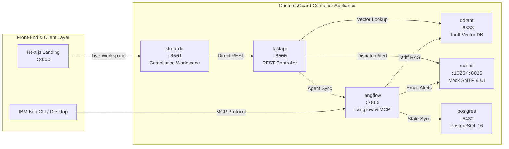
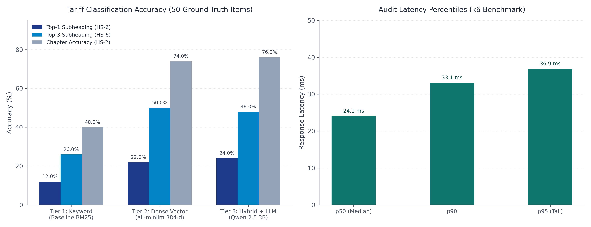

# CustomsGuard

[](https://www.docker.com/)
[](https://ollama.com/)
[](https://github.com/astral-sh/uv)
[](https://www.npmjs.com/)

**Autonomous Trade Compliance & Tariff Discrepancy Engine**  
_IBM SkillsBuild x Hacktiv8 National Hackathon 2026 (Productivity & Smart Business)_

CustomsGuard provides sub-second Harmonized System tariff classification across 5,612 official Indonesian codes, automated pre-import permit verification for restricted goods across SDPPI, Kemenkes, and BPOM schedules, and grounded demurrage modeling benchmarked against official CMA CGM Indonesia published tariff matrices.

The platform also uncovers duty overpayment restitution opportunities, automatically archives timestamped Markdown and JSON dossiers, and dispatches real-time detention alerts via SMTP whenever non-compliant cargo is detected.

<video src="https://github.com/user-attachments/assets/8da30cb2-9999-4702-89c9-ed2b6bbcd43c" controls width="100%"></video>

> 🎬 **Demo Walkthrough**: [YouTube](https://youtu.be/OBHL-cSZEY8) | [Github (Download)](https://github.com/user-attachments/assets/8da30cb2-9999-4702-89c9-ed2b6bbcd43c).

## The Problem & Strategic Context

Manual paperwork and documentation bottlenecks cost the global shipping ecosystem billions in direct operational expenses annually while holding back cross-border trade flow.[^mckinsey-trade]
While digital initiatives modernize customs filing, converting physical manifests into digital records does not eliminate the time-consuming process of verifying regulatory compliance.
Compliance teams frequently spend multiple hours per consignment checking invoices against constantly changing ministry regulations and tariff schedules.

In Indonesia, import declarations are audited against 5,612 standardized Harmonized System subheadings from the WTO and UNCTAD International Trade Centre dataset under the Directorate General of Customs and Excise framework.
Documentation errors and missing trade licenses frequently trigger customs red line inspections, causing compounding container detention liabilities and severe administrative surcharges that range from 100% to 1,000% on duty underpayments.[^uu-kepabeanan]
Conversely, conservative declarations lead importers to overpay import tariffs without discovering eligible tax restitution refunds.

CustomsGuard resolves these challenges by providing an automated audit pipeline that verifies trade manifests in under 50 milliseconds.
Operating air-gapped on private infrastructure, the platform preserves complete commercial data confidentiality while delivering mathematically exact tariff evaluations.

## System Architecture



CustomsGuard operates using a dual-channel architecture that isolates instant deterministic compliance calculations from multi-turn conversational agent reasoning.
The deterministic operator channel pairs Streamlit and FastAPI to execute vector lookups, demurrage assessments, dossier exports, and SMTP dispatches with sub-50ms latency.

For conversational reasoning and MCP tool access, requests route to Langflow where the agent reasons across multi-turn queries, navigates the tariff knowledge base, and synthesizes compliance guidance.
This decoupling ensures financial math and legal compliance checks remain mathematically exact while preserving flexible conversational assistance.

## Quickstart Guide

### 1. Launch Container Stack

```bash
cp .env.example .env
docker compose up -d
```

### 2. Seed Customs Tariff Database (5,612 HS-6 Codes)

```bash
docker compose exec customsguard-api python scripts/seed_qdrant.py
```

### 3. Import Langflow Workflow Templates

Navigate to `http://localhost:7860`, open **My Projects** -> **Import**, and upload the workflow templates:

- [`langflow/CustomsGuard.json`](./langflow/CustomsGuard.json): Autonomous Compliance Audit and MCP Tool Flow.
- [`langflow/CustomsGuard-Bot.json`](./langflow/CustomsGuard-Bot.json): Regulatory Knowledge Assistant Flow.
- [`langflow/CustomsGuard-Ingest.json`](./langflow/CustomsGuard-Ingest.json): Multimodal Document Ingestion and Verification Flow.

### 4. Configure Local Agent LLM

For an air-gapped, on-premise deployment without external API keys:

1. Pull the model on the host: `ollama pull qwen2.5:3b`.
2. Ensure Ollama listens on all interfaces by adding `Environment="OLLAMA_HOST=0.0.0.0"`.
3. In Langflow, set the model provider to Ollama with `http://host.docker.internal:11434`.

### Service Endpoints

- **Operator Dashboard**: `http://localhost:8501`
- **Landing Showcase**: `http://localhost:3000`
- **FastAPI Controller & Swagger**: `http://localhost:8000/docs`
- **Langflow Canvas & MCP**: `http://localhost:7860`
- **Mailpit Web UI**: `http://localhost:8025`
- **Qdrant REST API**: `http://localhost:6333`
- **PostgreSQL Database**: `localhost:5432`

## Running Automated Tests

Run the complete automated test suite from the host repository root:

```bash
uv run pytest -v
```

> Core tariff lookup, arithmetic, and regression tests run deterministically in under 10 seconds.
> The live conversational IBM Bob Shell E2E test is skipped by default to optimize velocity.
> To run the live IBM Bob Shell CLI test, set `RUN_E2E=1 uv run pytest -v` with `BOB_API_KEY` configured in `.env`.

## Empirical Benchmarks & Performance Verification



### 1. Tariff Classification Accuracy (50-Item Ground Truth Dataset)

Evaluated across 5,612 Indonesian HS-6 tariff lines:

- **Tier 1: Keyword Baseline**: Lexical BM25 token overlap.
- **Tier 2: Dense Semantic Vector**: Unit-normalized `all-minilm` 384-d Cosine search in Qdrant.
- **Tier 3: Hybrid + LLM Reranker**: Top-5 candidates reranked by Qwen 2.5 3B.

Dense semantic retrieval doubles exact HS-6 classification accuracy over keyword matching while correctly identifying the governing trade chapter in 76% of zero-shot declarations across 5,612 candidate tariff lines.

### 2. Execution Latency & Tail Throughput (Grafana k6 Load Test)

Tested under sustained concurrent load (10 virtual users over 60 seconds) against `POST /api/v1/audit`:

| Metric                   |   Measured Value    |    SLA Benchmark    | Status |
| :----------------------- | :-----------------: | :-----------------: | :----- |
| **p50 (Median Latency)** |    **24.08 ms**     |  $< 50\text{ ms}$   | Passed |
| **p90 Latency**          |    **33.14 ms**     |  $< 500\text{ ms}$  | Passed |
| **p95 (Tail Latency)**   |    **36.93 ms**     | $< 1,500\text{ ms}$ | Passed |
| **Max Recorded Latency** |    **170.21 ms**    | $< 5,000\text{ ms}$ | Passed |
| **Request Failure Rate** | **0.00%** (0 / 326) |     $< 1.00\%$      | Passed |

Load tested with Grafana k6 on local host environment (AMD Ryzen 5 6600H, 16GB RAM, 10 concurrent VUs over 60s).
Latency ceiling remained at p95 = 36.93 ms (over 100x buffer under the 5.0s SLA).
Because baseline tail latency is only 37 ms, even with a 5x to 10x slowdown on a 2 vCPU cloud container, worst-case execution remains well below 400 ms.

## Documentation & Scenarios Directory

| Category                    | Resource                                                                     | Description                                                                 |
| :-------------------------- | :--------------------------------------------------------------------------- | :-------------------------------------------------------------------------- |
| **Domain & Strategy**       | [`docs/domain/problem_solution.md`](./docs/domain/problem_solution.md)       | Deep analysis of customs bottlenecks, demurrage costs, and AI solution.     |
|                             | [`docs/domain/business_canvas.md`](./docs/domain/business_canvas.md)         | Business model canvas, ROI calculations, and operational cost analysis.     |
|                             | [`docs/domain/macmap.xlsx`](./docs/domain/macmap.xlsx)                       | Official WTO/UNCTAD ITC Market Access Map tariff dataset for Indonesia.     |
| **Technical Architecture**  | [`docs/technical/api_reference.md`](./docs/technical/api_reference.md)       | REST API and Model Context Protocol specification for Langflow and FastAPI. |
|                             | [`docs/technical/architecture.md`](./docs/technical/architecture.md)         | Canvas topology, node specifications, guardrails, and data contracts.       |
|                             | [`docs/technical/design_decisions.md`](./docs/technical/design_decisions.md) | Architectural rationale, permit verification, and enterprise design.        |
|                             | [`docs/technical/mcp_setup.md`](./docs/technical/mcp_setup.md)               | Connection guide for IBM Bob and Langflow MCP streamable transport.         |
| **Pipelines & Workflows**   | [`langflow/CustomsGuard.json`](./langflow/CustomsGuard.json)                 | Langflow visual pipeline export for Audit and MCP Tool flow.                |
|                             | [`langflow/CustomsGuard-Bot.json`](./langflow/CustomsGuard-Bot.json)         | Langflow visual pipeline export for Regulatory Assistant flow.              |
|                             | [`langflow/CustomsGuard-Ingest.json`](./langflow/CustomsGuard-Ingest.json)   | Langflow visual pipeline export for Document Ingestion flow.                |
| **Test Fixtures & Outputs** | [`scenarios/prompts/`](./scenarios/prompts/)                                 | Modular prompts for high-risk audits, demurrage, and restitution.           |
|                             | [`data/seed/sample_invoices.json`](./data/seed/sample_invoices.json)         | Benchmark invoice manifests covering multi-commodity scenarios.             |
|                             | [`scenarios/expected-outputs/`](./scenarios/expected-outputs/)               | Reference audit reports matching canonical test cases.                      |

[^mckinsey-trade]: Casanova, D., Dierker, D., Jensen, B., Hausmann, L., & Stoffels, J. (2022, November 29). The multi-billion-dollar paper jam: Unlocking trade by digitalizing documentation. McKinsey & Company. https://www.mckinsey.com/industries/logistics/our-insights/the-multi-billion-dollar-paper-jam-unlocking-trade-by-digitalizing-documentation

[^uu-kepabeanan]: Republic of Indonesia. Law No. 17 of 2006 amending Law No. 10 of 1995 on Customs (Undang-Undang Kepabeanan), Article 82(5) and Article 16(4); implemented via Government Regulation (PP) No. 39 of 2019.
