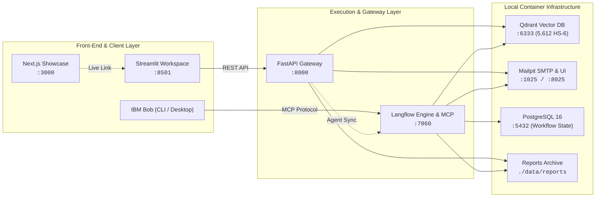

# CustomsGuard Technical Architecture & Pipeline Specification

This document provides a technical specification of the CustomsGuard system topology, dual-channel execution architecture, Langflow canvas pipelines, and Model Context Protocol (MCP) interface with IBM Bob.

## 1. System Topology Overview

CustomsGuard combines an autonomous agent execution engine with a sub-50ms deterministic audit controller in local Docker containers:

## 2. Langflow Visual Canvas Pipelines

CustomsGuard provides three pre-configured visual pipeline definitions in `./langflow/`:

### Pipeline A: Primary Autonomous Audit Flow (`CustomsGuard.json`)

The primary compliance flow automates invoice verification, regulatory permit checks, and evidence generation:

1. **Node 1 (Chat Input)**: Accepts raw commercial invoice JSON strings or trade shipment metadata.
2. **Node 2 (CustomsGuard Tools)**: Custom Python component ([`scripts/customs_components.py`](../../scripts/customs_components.py)) exposing `audit_shipment_compliance`, `export_compliance_report`, and `send_compliance_alert`.
3. **Node 3 (Agent Orchestrator)**: Autonomous LLM agent driven by [`scenarios/prompts/system_agent_instruction.md`](../../scenarios/prompts/system_agent_instruction.md).
4. **Node 4 (Safety Guardrails)**: Verifies that outputs do not leak internal tokens or passwords, redacts Personally Identifiable Information (PII), and protects against prompt injections.
5. **Node 5 & 6 (Chat Output)**: Separate pass and fail routes delivering structured executive audit findings or security policy notices.

### Pipeline B: Regulatory Knowledge Assistant (`CustomsGuard-Bot.json`)

A dedicated conversational pipeline grounded in official Indonesian customs regulations and Lartas ministry schedules:

1. **Chat Input & History**: Tracks multi-turn conversational context for compliance inquiries.
2. **Tariff Vector Retrieval**: Embeds and matches queries against 5,612 Indonesian HS-6 subheadings in Qdrant.
3. **Synthesis Engine**: Answers importer questions regarding mandatory ministry permits (SDPPI, Kemenkes, BPOM) and MFN duty schedules.

### Pipeline C: Document Ingestion & Verification (`CustomsGuard-Ingest.json`)

A focused multimodal extraction and verification pipeline that transforms unstructured commercial invoice files into validated trade manifests:

1. **Chat Input**: Receives parsed document text and shipping declarations dispatched from the API gateway.
2. **Ingestion Validator Tools**: Custom Python component ([`scripts/ingestion_validator.py`](../../scripts/ingestion_validator.py)) that inspects extracted document payloads, strips surrounding conversational text or markdown blocks, verifies strict JSON syntax, and enforces mandatory customs line-item completeness.
3. **Extraction Agent**: Autonomous LLM agent that interprets commercial descriptions, extracts 6-digit Indonesian HS codes, checks commodity quantities and values, and invokes the validator tool to guarantee compliant JSON output.
4. **Chat Output**: Delivers the verified invoice payload or structured rejection notice back to the FastAPI gateway and Streamlit workspace.

## 3. Model Context Protocol (MCP) Interface

CustomsGuard exposes its complete audit pipeline as an MCP tool using the Streamable HTTP transport.
Client setup details are documented in [`docs/technical/mcp_setup.md`](./mcp_setup.md) and [`.bob/mcp.json`](../../.bob/mcp.json).

### Tool Specification

- **Tool Name**: `customsguard`
- **Transport**: `streamablehttp` via `mcp-proxy` (`mcp<2.0.0`)
- **Input Parameters**:
  - `input_value`: Serialized JSON invoice string or natural-language audit instruction.
  - `session_id`: Optional identifier to persist compliance state across multi-turn sessions.

### Execution Sequence

1. IBM Bob receives an audit instruction (e.g., `$audit-shipment SHP-2026-0042` or pasted invoice payload).
2. Bob executes the `customsguard` MCP tool hosted on Langflow (`:7860`).
3. Langflow runs the visual pipeline, querying Qdrant tariffs, calculating demurrage liabilities, exporting dossiers, and dispatching Mailpit alerts.
4. Langflow passes the synthesized audit through the AI Safety Guardrails node.
5. Bob receives the sanitized response and renders the executive summary to the compliance officer.

## 4. Front-End Interfaces & Centralized REST Gateway

CustomsGuard provides two web-based user interfaces and a high-speed REST controller:

- **Streamlit Operator Workspace (`:8501`)**:
  Declarative interactive interface in [`ui/app.py`](../../ui/app.py) for loading canonical scenarios, tuning container parameters, running live audits, and reviewing archived dossiers.
- **Next.js Landing Showcase (`:3000`)**:
  Modern dark-themed marketing and interactive demo showcase in [`web-landing/`](../../web-landing/) presenting problem context, feature highlights, and interactive audit scenarios.
- **FastAPI Controller (`:8000`)**:
  Centralized gateway in [`api/main.py`](../../api/main.py) serving sub-50ms deterministic audit endpoints (`/api/v1/audit`), stack health checks (`/api/v1/health`), dossier archives (`/api/v1/reports`), and Swagger UI documentation at `http://localhost:8000/docs`.
  For full schema details, see [`docs/technical/api_reference.md`](./api_reference.md).

## 5. Dense Semantic Vector Architecture & Seeding Pipeline

CustomsGuard indexes the complete Indonesian HS-6 customs tariff schedule (5,612 subheadings from the WTO/UNCTAD ITC Market Access Map dataset) in Qdrant using dense vector embeddings.

### Embedding Model & Vector Space

- **Embedding Model**: `all-minilm` (`sentence-transformers/all-MiniLM-L6-v2`) hosted locally via Ollama (`:11434/api/embeddings`).
- **Vector Dimensionality**: 384 dimensions, unit-normalized ($\|\mathbf{v}\|_2 = 1.0$).
- **Distance Metric**: Cosine distance in Qdrant collection `customs_tariffs`.

### Seeding Workflow (`scripts/seed_qdrant.py`)

1. Ingests raw tariff entries and regulatory license schedules from `data/seed/tariff_database.json`.
2. Generates 384-dimensional dense semantic vectors using `all-minilm` via Ollama with batch processing.
3. Persists precomputed embeddings to disk cache at `data/seed/tariff_embeddings_384.json` to enable instant offline container initialization.
4. Seeds and indexes the `customs_tariffs` collection in Qdrant with payload metadata including HS codes, MFN duty rates, restriction flags, and required ministry permits.

### Real-Time Query Retrieval (`scripts/customs_components.py`)

1. Converts incoming declared commodity descriptions into a 384-dimensional query vector using local `all-minilm`.
2. Executes a Top-5 vector search in Qdrant to retrieve the closest official tariff candidates.
3. If Ollama is temporarily unavailable, the query pipeline falls back to a deterministic projection to maintain uninterrupted service.
